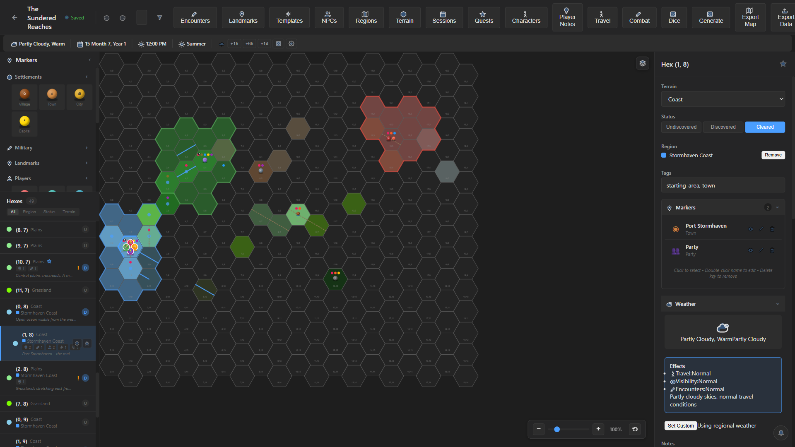

# Hexal

[](https://opensource.org/licenses/MIT)
[](https://github.com/ringo380/hexal/releases/latest)
[](https://hexal.online/)

A desktop application for running D&D hex crawl campaigns on macOS, Windows, and Linux, built with Electron, React, and TypeScript.



## Features

### Build the world
- **Hex grid editor**: canvas-rendered hex map with customizable terrain, level-of-detail zoom, and smooth pan and zoom
- **Content per hex**: locations, encounters, NPCs, treasures, and clues, each with resolve tracking
- **Regions**: named regions with colored borders, labels, paint mode, and flood-fill selection
- **Rivers, roads, and markers**: hex-edge rivers and roads, plus draggable figurine-style markers
- **Terrain editor**: custom terrain types with colors, icons, move costs, elevation, hazards, and categories
- **Procedural generation**: seeded terrain, encounter, and landmark generation with density controls
- **Campaign templates**: start from one of ten built-in settings, or import, customize, and share your own

### Run the table
- **Combat tracker**: initiative order, HP, conditions, and rounds, with quick-add from encounters
- **Dice roller**: standard notation, advantage and disadvantage, hidden DM rolls, and shared roll history
- **Quests and story arcs**: objectives, status, prerequisites, links to hexes and NPCs, and a quest graph
- **Characters and travel**: party tokens on the map, A* route planning, and a travel log
- **NPCs and factions**: NPC directory with attitudes, faction membership, and a relationship network
- **Time and weather**: in-game calendar with a weather simulation, radar overlay (pressure, fronts, clouds, wind), and ambient weather audio
- **Session log**: timeline of sessions with tags, in-game timestamps, and per-hex events

### Share with players
- **Player view**: a second window with fog of war, safe to put on a shared screen
- **Web player**: players join from a browser on the local network with a PIN, including phones and tablets
- **Messaging, journals, and encounter reveals** pushed live to player views

### Everything else
- Autosave, 50-step undo and redo, multiple windows, and a command palette (Ctrl+K / Cmd+K)
- Export maps to PNG, JPEG, or PDF, and campaign data to JSON or Markdown
- Optional account sign-in with offline-first cloud sync

## Installation

Download the latest release from the [Releases page](https://github.com/ringo380/hexal/releases/latest).

### Windows
- `Hexal.Setup.<version>.exe` installs Hexal; `Hexal.<version>.exe` is a portable build that runs without installing.
- The builds are not code-signed, so Windows SmartScreen may warn on first launch. Choose **More info**, then **Run anyway**.

### macOS
- Download the `.dmg` for your Mac: `-arm64` for Apple Silicon, the other for Intel.
- Open it and drag Hexal to Applications.
- The app is not notarized. If macOS blocks it, open **System Settings > Privacy & Security** and choose **Open Anyway**.

### Linux
- `Hexal-<version>.AppImage`: make it executable (`chmod +x`) and run it.
- `hexal_<version>_amd64.deb`: install with `sudo apt install ./hexal_<version>_amd64.deb`.

Campaigns are saved in a `Hexal` folder inside your Documents folder.

## Documentation

Visit [hexal.online](https://hexal.online/) for feature screenshots and a getting-started guide. Release notes are in [CHANGELOG.md](CHANGELOG.md).

## Development

Requires Node.js 22 or later.

```bash
npm ci                  # Install dependencies
npm run dev             # Start the Vite dev server and Electron
npx tsc --noEmit        # Type check
npm test                # Run the unit tests (Vitest)
npm run build           # Production build for the current platform
npm run build:win       # Windows installer and portable build
npm run build:mac       # macOS DMG and ZIP (x64 and arm64)
npm run test:e2e        # Electron smoke tests (needs npm run dev running)
npm run screenshots     # Regenerate docs/screenshots (needs npm run dev running)
```

## Tech Stack

- **Frontend**: React 18, TypeScript, HTML5 Canvas
- **Desktop**: Electron 41, electron-builder
- **Build and test**: Vite 8, Vitest, Playwright
- **State**: React Context + useReducer
- **Optional services**: Clerk (accounts) and Supabase (cloud sync)

## Project Structure

```
hexal/
├── electron/          # Main process: windows, menus, file I/O, web player server
├── src/
│   ├── components/    # React components, grouped by feature
│   ├── stores/        # React contexts (campaign, selection, sync, combat, ...)
│   ├── services/      # Rendering, generation, weather, sync, and other logic
│   ├── types/         # TypeScript types, one file per domain
│   ├── data/          # Default tables and campaign templates
│   └── styles/        # CSS
├── docs/              # Website (hexal.online) and screenshots
├── e2e/               # Smoke tests and screenshot capture
└── supabase/          # Database migrations for cloud sync
```

## Contributing

Contributions are welcome. See [CONTRIBUTING.md](CONTRIBUTING.md) for guidelines.

## License

This project is licensed under the MIT License. See the [LICENSE](LICENSE) file for details.
